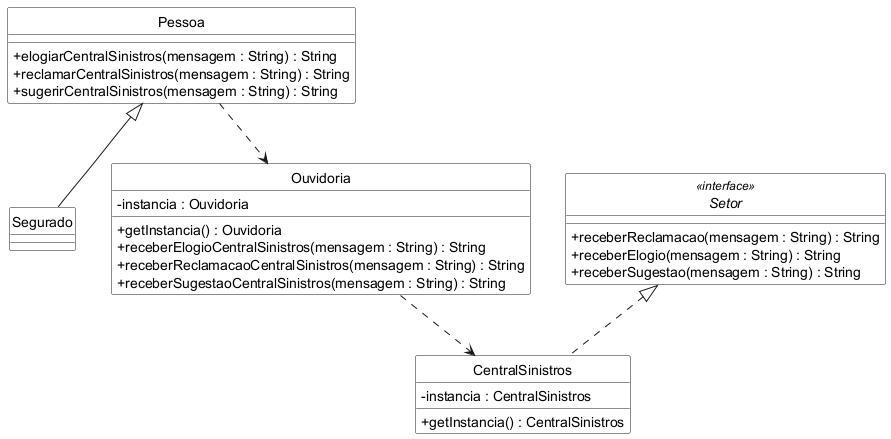

# Mediator

Trabalho da disciplina Aspectos Avançados em Engenharia de Software.

Exemplo do padrão Mediator em Java, com testes em JUnit 5. O tema é o mesmo da
seguradora usada nos trabalhos anteriores: o segurado pode mandar um elogio,
uma reclamação ou uma sugestão para a Central de Sinistros.

O segurado não fala direto com a Central de Sinistros. Tudo passa pela
Ouvidoria, que leva a mensagem até o setor e devolve a resposta. Assim o
segurado só conhece a Ouvidoria, e a Ouvidoria é quem sabe com qual setor falar.

## Diagrama de classes

